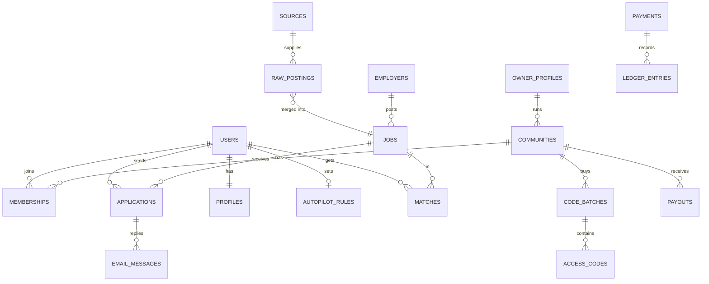

# i-jobs engine: database

PostgreSQL 16+ with pgvector. One database serves i-jobs, Remote Hustle, School1 and any future site.

```
db/
  migrations/0001_init.sql          the full schema: 61 tables, 9 views, rules and triggers
  seeds/0001_reference_data.sql     sites, 27 job sources with their rules, Groq models, AI budgets
  tests/schema.test.mjs             runs both on an in-memory Postgres and checks 19 rules
```

## Run it

**Tests (no database needed):**

```bash
cd db/tests
npm install
npm test
```

They use PGlite (Postgres compiled to WebAssembly) with pgvector, so nothing has to be installed.

**On the Oracle server (or any Postgres 16+):**

```bash
psql "$DATABASE_URL" -f db/migrations/0001_init.sql
psql "$DATABASE_URL" -f db/seeds/0001_reference_data.sql
```

Use the `pgvector/pgvector:pg16` Docker image so the `vector` extension is already there. The seed can be run again at any time; it updates rows in place.

Before production, replace everything marked `REPLACE-ME` (partner key hashes) and the `.example` sending domains.

## How it's organised

| Area | Tables | What it holds |
|---|---|---|
| Sites and people | `sites`, `users`, `site_accounts`, `consents`, `guardian_consents`, `auth_codes`, `apply_meter`, `staff_members` | One person across every site, consent per purpose, age checks, the free-apply counter |
| Communities | `owner_profiles`, `communities`, `community_verifications`, `community_strikes`, `community_invites`, `memberships`, `trial_claims` | Owner checks, pricing, invites, trials, member progress |
| Selar codes | `code_batches`, `access_codes` | Prepaid single-use codes |
| Money | `payments`, `ledger_entries`, `payouts`, `refunds`, `fraud_signals` | Paga payments and our own double-entry ledger |
| Job sources | `sources`, `source_boards`, `source_runs` | Each source's rules, company boards, health checks |
| Employers | `employers`, `employer_members`, `employer_integrations` | Verification and ATS keys (encrypted) |
| Jobs | `raw_postings`, `jobs`, `job_sources`, `job_link_checks`, `job_reports`, `scam_signatures`, `moderation_items` | Raw imports, merged clean jobs, credit, scams, review queue |
| Matching | `profiles`, `autopilot_rules`, `trainings`, `matches`, `apply_packs` | CV profile, rules, courses for skill gaps, scores |
| Applying | `applications`, `application_events`, `outcome_checkins`, `send_counters`, `sending_domains`, `relay_addresses`, `email_messages`, `email_suppressions` | Applications, the four limits, the email relay |
| AI | `ai_models`, `ai_task_budgets`, `ai_usage_daily`, `ai_calls`, `training_examples` | Groq free limits, the daily token budget, future training data |
| Everything else | `notifications`, `faq_articles`, `support_tickets`, `support_messages`, `webhook_endpoints`, `webhook_deliveries`, `audit_log`, `data_requests` | Alerts, support, partner webhooks, compliance |



## Rules the database enforces

The application should still check these, but the database refuses anything that breaks them:

- **Community price:** at least ₦5,000 (500,000 kobo). Only the owner onboarding page shows this; public pages never show prices.
- **Demo tours:** at most two per community.
- **Free trials:** one per person across all communities, checked by phone and by payment card.
- **Referral credit:** a member stays credited to the community that brought them. It can only move when that community has been banned and the member switches.
- **Banned communities:** their unused Selar codes are voided and their pending payouts are frozen, automatically.
- **Codes:** single-use, never expire, and the batch records that the owner accepted "non-refundable".
- **Jobs:** nothing stays live more than 60 days.
- **Applications:**
  - never applied to the same job twice;
  - autopilot can only use on-platform, the email relay or an employer's key, and always has a cancel window;
  - every status change is logged.
- **Sending limits:** `try_count_send()` stops at the cap for each job, employer, user and sending domain.
- **Owner privacy:** owners only see first names and progress through `owner_member_list` and totals through `community_funnel`. No email, phone, CV or applications.
- **Money:** every event in the ledger must balance to zero. `ledger_unbalanced` should always be empty.
- **Site isolation:** row-level security keeps each partner site to its own rows. The API connects as a non-owner role and sets `app.site_id` per request; background workers set `app.role = 'engine'`.

## The AI token budget (Groq free tier only)

Groq's free plan gives each model about 200,000 tokens and 1,000 requests a day, plus 30 requests and 8,000 tokens a minute, shared across the whole account. The schema keeps 10% spare, so 180,000 usable tokens a model.

| Task | Model | Tokens a day | Per call | About |
|---|---|---|---|---|
| CV parsing | gpt-oss-20b | 50,000 | 3,000 | 16 new profiles |
| Scam check (messy text only) | gpt-oss-20b | 30,000 | 800 | 37 jobs |
| Job extraction (messy text only) | gpt-oss-20b | 100,000 | 1,500 | 66 jobs |
| Tailored application paragraph | gpt-oss-120b | 180,000 | 1,400 | 128 applications |
| Sorting replies | qwen3.8-27b | 60,000 | 600 | 100 replies |
| Apply packs (on demand) | qwen3.8-27b | 100,000 | 2,000 | 50 packs |
| Support answers (FAQ miss only) | qwen3.8-27b | 20,000 | 1,500 | 13 answers |

The qwen model is a preview, so it falls back to gpt-oss-20b when switched off or full.

**How a worker uses it:**

```sql
-- 1. Before the call: reserve. Returns the model to use, or NULL if today's budget is spent.
SELECT ai_reserve('app_paragraph');            -- uses the task's usual estimate
SELECT ai_reserve('cv_parse', 4200);           -- or pass your own estimate

-- 2. After the call: swap the reservation for the real token counts.
SELECT ai_settle(current_date, 'groq:openai/gpt-oss-120b', 'app_paragraph', 1400, 1180, 190);

-- 3. If the call failed, give the tokens back.
SELECT ai_settle(current_date, 'groq:openai/gpt-oss-120b', 'app_paragraph', 1400, 0, 0, true);
```

When `ai_reserve` returns NULL, the worker re-queues the job for after midnight UTC, and the user sees "Scheduled for tomorrow". The per-minute limits (30 requests, 8,000 tokens) are handled by the BullMQ rate limiter in Redis, not here. `ai_budget_today` shows what's left; `ai_budget_plan_check` confirms the plan fits each model.

Groq lists the same numbers for its paid Developer plan on its rate-limits page, so check the real free limits on your account's limits page after setup and update `ai_models` if they differ. To move to paid later, change `plan` and the limits; nothing else changes.

## Design notes

- **Merging duplicates:** when the same job arrives from several sources, the most direct source becomes the primary one (employer post, then applicant-system feed, then remote board, then aggregator). Autopilot reads the primary source's rules through `matchable_jobs`, so an aggregator copy of a job we also have from Greenhouse can still be auto-applied to.
- **What AI never touches:** structured feeds (`needs_ai_extraction = false`), match scores and reasons (Voyage embeddings plus code), the application email around the tailored paragraph (a template filled from the profile), and the check that the paragraph only mentions skills from the profile.
- **Embeddings:** `vector(1024)` for Voyage voyage-4, with HNSW indexes on jobs, profiles, trainings, FAQs and confirmed scams.
- **Files and secrets:** CVs, raw emails and ID documents are stored in R2; tables keep only keys. Employer ATS keys are encrypted by the app before they reach the database.
- **Training data:** `training_examples` only accepts rows marked consented and anonymised.

## Still open (columns exist, values to decide)

- `communities.billing_period` and `platform_share_bps`: the subscription period and i-jobs' percentage.
- `code_batches.grants_period`: how long a Selar code's access lasts.
- `refunds`: the refund policy for regular memberships.
- `data_requests.due_at`: defaults to 30 days; confirm the legal deadline with your DPO.
- Notifications: the `notifications` table is ready; which alerts to send, and how often, is still to decide.


## A rule for views

Never write a view as `SELECT j.*`, or if you do, rebuild it in any migration that adds columns to
that table: Postgres expands `*` once, when the view is created. `matchable_jobs` is rebuilt in
`0004_matching.sql` for this reason.
